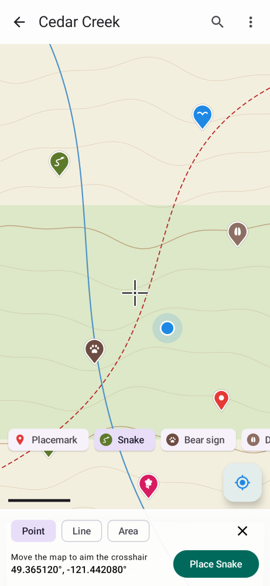
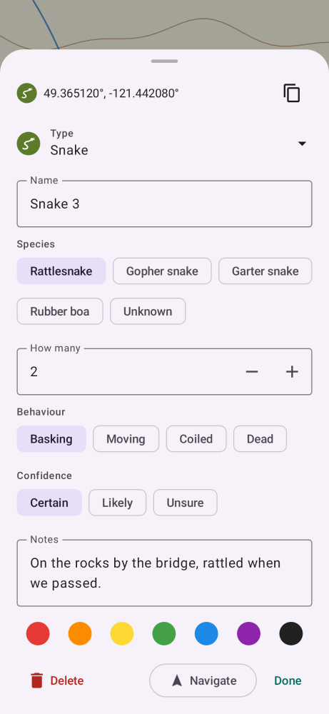
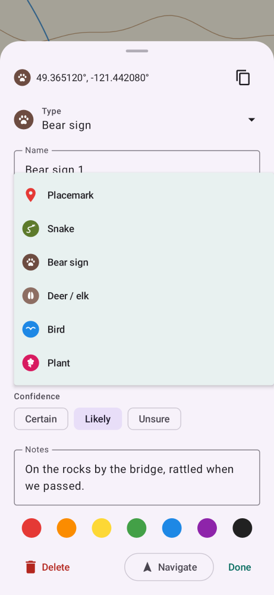
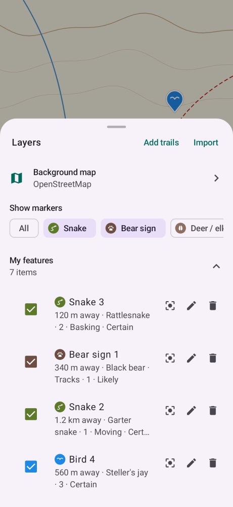
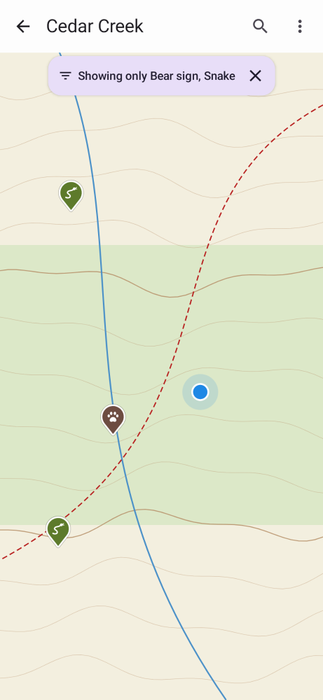
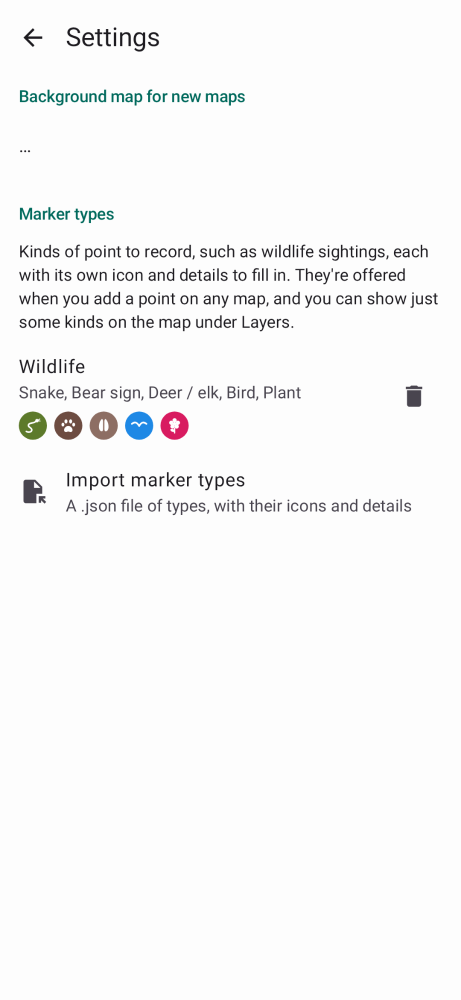

# Marker types

Custom kinds of point (a snake sighting, bear sign, a flowering plant) that you import once in Settings and then use on every map. Each type has an icon, a colour, and details to fill in. You can then show only some types on the map.

This file is the plan. It also documents the file format. The first version described here is built; [Later](#later) lists what isn't.

## Goals

- **Nobody has to use it.** With no marker types imported, the app looks and works exactly as before.
- **Logging a sighting is fast.** With gloves on, at a trailhead: tap **+**, tap the type (it remembers the last one), then tap **Place**. The sheet opens with the type's defaults already filled in.
- **It works for any subject.** Wildlife is the example, but the same file can describe trail damage, campsites, water sources or survey plots. The app knows nothing about snakes.
- **It's easy to build.** No new screens. It adds to the **+** panel, the placemark sheet, the Layers list and Settings. The file is plain JSON that you can write by hand.

## How it works for the user

1. **Settings → Marker types → Import marker types** and pick a `.json` file, or tap **Add the Wildlife example**. Settings lists each imported set with its icons, and each set can be deleted. Importing a file again with the same `id` replaces that set, so you can edit a file and import it again.
2. **On a map, tap +.** When marker types exist, *Point* mode shows a strip of chips floating over the map, just above the panel: *Placemark*, then each type with its icon. The strip is outside the panel because the panel keeps the same height in every mode, so the crosshair never moves. The chosen type is remembered across maps and restarts. The button reads **Place Snake**.
3. **Placing it** names it after the type ("Snake 4"), gives it the type's colour, fills in default values, and opens the sheet.
4. **The placemark sheet** has a **Type** menu above the name, so a long-press → *Add point* placemark can be given a type afterwards. The type's fields appear between *Name* and *Notes*:
   - *choice* fields as chips (tap the chosen one again to clear it)
   - *number* fields with − / + steppers
   - *text* fields as text boxes

   Changing the type changes the colour, fills in the new type's defaults, and renames the placemark if it still had its default name ("Placemark 3" → "Snake 3").
5. **On the map**, typed markers are pins with a slightly larger head that holds the icon in white.
6. **Filtering.** **Layers** has a **Show markers** row of chips (*All*, then each type used on this map, then *Placemarks*). Tapping a type shows only that type. Tapping more types adds them, and *All* resets. While a filter is on, a banner under the top bar says "Showing only Snake" and has a ✕ to clear it, so hidden markers aren't mistaken for lost ones. The filter affects points only; lines, areas and tracks stay. It lasts while the map is open.
7. **Search** also matches type names and detail values ("rattle" finds rattlesnakes).
8. **The Layers list** shows each marker's icon and its details ("300 m away · Rattlesnake · 2 · Basking").
9. **Export:** KML writes the type and every detail as `<ExtendedData>`, which QGIS, Google Earth and others read as attribute columns. GPX writes the type name in `<type>` and the details in `<cmt>`.

## Screens

These are rendered from the app's real composables with [Paparazzi](https://github.com/cashapp/paparazzi). The map behind them is a stand-in, and the sheets are laid out the way `ModalBottomSheet` shows them. They aren't screenshots from a device.

| | | |
|---|---|---|
|  |  |  |
| **+**: pick a type, aim, place | The sheet: type and details | Changing a placemark's type |
|  |  |  |
| Layers: *Show markers* and details | Filtered, with the banner | Settings → Marker types |

## File format

JSON, UTF-8. The smallest useful file is a list of names:

```json
[{ "name": "Snake" }, { "name": "Bear" }]
```

That list is named after the file. The full form is a set:

```json
{
  "id": "wildlife",
  "name": "Wildlife",
  "fields": [
    { "key": "confidence", "label": "Confidence", "type": "choice",
      "options": ["Certain", "Likely", "Unsure"], "default": "Certain" }
  ],
  "types": [
    {
      "id": "snake",
      "name": "Snake",
      "color": "#5D7A2B",
      "icon": "<svg viewBox='0 0 24 24'>…</svg>",
      "fields": [
        { "key": "species", "label": "Species", "type": "choice",
          "options": ["Rattlesnake", "Gopher snake", "Garter snake", "Unknown"] },
        { "key": "count", "label": "How many", "type": "number", "default": 1 }
      ]
    }
  ]
}
```

| Key | Where | Meaning |
|---|---|---|
| `id` | set, type | Stable identifier. Defaults to the name in lower case with dashes. Markers store `set-id/type-id`, so keep ids fixed when renaming. |
| `name` | set, type | Shown in the app. Required for types. |
| `color` | type | `#RRGGBB` or `#AARRGGBB`. Defaults to grey. |
| `icon` | type | An SVG (see below), or bare path data such as `"M12 2L2 22h20z"` in a 24×24 box. Optional: without one the type gets a plain pin in its colour. |
| `fields` | set, type | Details to fill in. The set's fields are added after each type's own fields. |
| field `key` | | Where the value is stored and the name used in exports. Defaults to the label. |
| field `label` | | Shown in the sheet. |
| field `type` | | `text` (the default), `number` or `choice` (`select` also works). |
| field `options` | | Required for `choice`. |
| field `default` | | Filled in when a marker is placed. |

Limits: 200 types per file, 1 MB per file, 20,000 characters per icon.

**Icons** are drawn in one colour: white on the type's colour in pins, chips and lists. The app reads a small part of SVG:

- the shapes `path`, `circle`, `ellipse`, `rect`, `line`, `polyline` and `polygon`
- `g` groups
- `viewBox` (or `width` and `height`)
- the attributes and `style` properties `fill="none"`, `stroke`, `stroke-width`, `stroke-linecap` and `fill-rule`

Colours, gradients, transforms, text and `<use>` are ignored. Single-colour icon sets such as Material Symbols, Tabler or Lucide work as they are. Check an icon set's license before putting its icons in a file you share. The example icons in `app/src/main/assets/marker-types/wildlife.json` were drawn for this app and are under the app's MIT license.

**Why JSON:** it's the one format here that holds nested fields and inline SVG, is easy to write by hand or generate from a spreadsheet, and the app already parses it. Other formats can be converted into the same model later (see [Later](#later)).

## How it's built

| Piece | Where |
|---|---|
| Model, file parser, SVG-subset parser (pure Kotlin, unit-tested) | `data/MarkerTypes.kt` |
| `Feature.markerType` (`"set/type"` or null) and `Feature.attributes` (key → value), saved in `features.json` | `data/Feature.kt`, `data/MapLibrary.kt` |
| Imported sets, kept in settings as their original text and read again on start; the last type used | `data/Settings.kt` |
| Icons as Compose paths (cached), `MarkerBadge` | `ui/map/MarkerIcons.kt` |
| Pins with icons | `ui/map/MapOverlay.kt` (`drawPin`) |
| Type picker, field editors, `retype` | `ui/map/MarkerFields.kt` |
| Type chips in **+**, filter banner, filter state | `ui/map/MapScreen.kt` |
| Type in the sheet, Layers icons and details, **Show markers** | `ui/map/FeatureSheets.kt` |
| Settings section | `ui/MarkerTypesSettings.kt` |
| KML/GPX export | `data/FeatureExport.kt` |
| Search | `ui/map/SearchPanel.kt` |

Design choices:

- **Markers keep their own data.** A marker stores its type id, its colour and its values. Deleting a set (or editing a file) never changes or loses existing markers. A marker whose type is gone shows as a plain pin in its colour, with its values still visible and editable. Values whose field was removed stay too, shown as text fields named by their key.
- **Sets are stored as the file's text** and parsed on start. A later version that understands more of the format (say, a `date` field) can then use files imported earlier.
- **Types are global, markers are per map,** like everything else drawn on a map. Types live in Settings, not with maps.
- **The filter isn't saved.** It's a way of looking at the map, and a filter left on by mistake would hide markers the next time the map is opened.

## Later

In rough order of value against effort:

1. **Read the type back from KML.** Importing a KML file with `typeId` in its ExtendedData would restore the type and values when the set is installed. Without that, the values would at least go into the notes. Export already writes everything this needs.
2. **Save the filter per map,** if people want it to persist, with the banner kept so it can't be forgotten.
3. **Filter across all maps:** a *Sightings* screen next to *Tracks*, listing every marker of a type on every map, with export. This is where "how many rattlesnakes this year" gets answered.
4. **Record the time and GPS accuracy** with each marker automatically (`createdAt` is already stored), and show them in the sheet.
5. **More field types:** `date`/`time`, `yesno`, multi-choice, and a `photo` field (camera intent, file stored with the map). Unknown field types would then be kept rather than rejected, for files written for a newer app.
6. **Other ways in:** opening a `.json` from another app ("Open with"), or a zip of SVG files plus a CSV of names and colours, converted into the same model.
7. **Type-aware import:** GPX `<type>` or KML style names matched to type names on import.
8. **Edit types in the app** (name, colour, fields), for people who'd rather not write JSON. Icons would still be imported.
